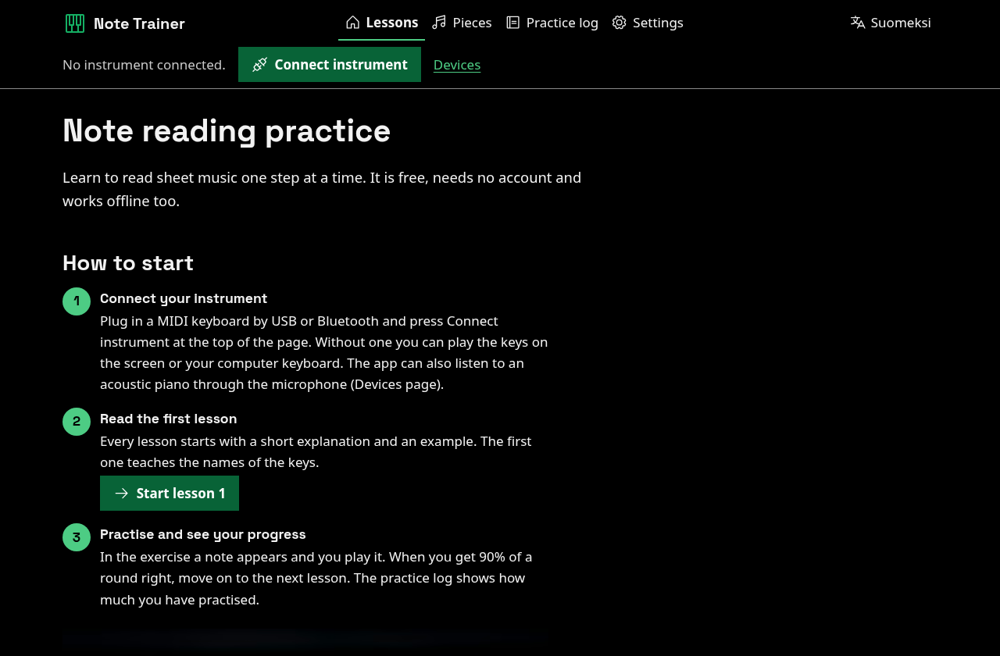

# Nuottitreeni

Ilmainen verkkosovellus nuottien lukemisen ja soittamisen harjoitteluun pianolla tai kosketinsoittimella. Se toimii selaimessa, tukee lähes mitä tahansa MIDI-kosketinsoitinta, toimii myös ilman verkkoyhteyttä ja tallentaa edistymisesi vain omaan selaimeesi. Suomeksi ja englanniksi.

**Käytä ilmaiseksi osoitteessa <https://piano.markussilvo.fi>.** Se on tekijän ylläpitämä virallinen palvelu. Voit myös asentaa oman kopion Cloudflareen yhdellä painikkeella (ohje alempana).

[In English](README.md)



## Mitä sovellus tekee

- **Helppo aloittaa.** Etusivulla on kolme askelta: yhdistä soitin (tai käytä näytön koskettimia), lue oppitunti 1 ja harjoittele. Jokaisen harjoituksen alussa on ensimmäisellä kerralla lyhyt Näin harjoittelet -laatikko: numeroidut askeleet ja esimerkki, jossa nuotti on viivastolla, sen lukeminen selitetään ja soitettava kosketin näytetään.
- **Oppitunnit nuottien lukemiseen.** Kymmenen lyhyttä oppituntia koskettimien nimistä G- ja F-avaimeen, apuviivoihin, ylennys- ja alennusmerkkeihin ja etumerkintään. Jokainen oppitunti selittää asian selkokielellä ja näyttää esimerkin, sitten harjoitellaan: yksi nuotti kerrallaan, nuottirivi, korvalla tai nimeämällä nuotti painikkeista (soitinta ei tarvita). Kun vastaus menee väärin tai pyydät vihjeen, sovellus kertoo miksi (mikä viiva tai väli ja mitä nuottiavain siitä tekee).
- **Vapaa harjoitus.** Valitse itse nuottiavain, nuottialue, etumerkintä ja ylennys- ja alennusmerkit, ja harjoittele juuri niitä nuotteja, joita tarvitset.
- **Lisää harjoituksia.** Fraasit: lyhyitä sävelmiä neljällä tasolla, luettavaksi ja soitettavaksi kuin oikeaa musiikkia. Pikaluku: vapaaehtoinen ajastettu peli, jossa jokainen oikea vastaus nopeuttaa seuraavaa nuottia. Tutki nuotteja: soita mitä tahansa kosketinta tai useampaa, niin näet nuotin viivastolla nimineen tai välin tai soinnun (C-duuri, 1. käännös).
- **Nuottien nimet haluamallasi tavalla.** Kirjaimet (C D E), suomalainen H-järjestelmä (C D E ... A H) tai do re mi. Halutessasi värit nuotin nimen (C punainen, D oranssi, E keltainen ja niin edelleen), käden tai sormen mukaan koskettimissa, putoavissa nuoteissa ja nimipainikkeissa, ja nimet myös mustissa koskettimissa; nimet näkyvät aina myös.
- **Rytmi.** Nuottiarvot, tauot ja tahtilajit ajastamattomina tehtävinä sekä rytmien soittaminen metronomin kanssa.
- **Kappaleet.** Yksitoista tekijänoikeuksista vapaata sävelmää Ukko Noasta ja Tuiki tuiki tähtösestä Für Elisen teemaan ja Chopinin e-molli-preludin alkuun, soitettavaksi nuoteista. Sovellus odottaa oikeaa nuottia tai etenee valitsemassasi tempossa (nopeuspainikkeet 50, 75 ja 100 % suositellusta temposta) ja voi toistaa tahtirivistä valitut tahdit. Kolmessa kappaleessa on bassolinja: harjoittele yhtä kättä, niin sovellus soittaa toisen. Kappaleen voi soittaa toisessa sävellajissa. Tempotila kertoo, mitkä nuotit tulivat ajallaan, aikaisin tai myöhässä, ja jokainen kerta saa pisteet, jotka jäävät lyhyeen historiaan. Nuotteihin saa nimet ja ehdotetun sormituksen, koskettimiston yläpuolelle putoavat nuotit (nimin tai sormin), värit nuotin, käden tai sormen mukaan, tahtinumerot, harjoittelun koko näytöllä, ja nuotit voi tulostaa. Voit avata myös omia MusicXML-, MXL- tai MIDI-tiedostoja; ne eivät lähde selaimestasi.
- **Oma soittimesi.** USB- ja Bluetooth-MIDI-soittimet Web MIDIn kautta. Bluetooth LE MIDI -soittimet ja osa vanhemmista USB-soittimista (esimerkiksi Yamahan mallit valmistajan omassa USB-tilassa) voi yhdistää suoraan Chromium-selaimissa (kokeellinen). Näytön koskettimet ja tietokoneen näppäimistö toimivat aina, ja akustinen piano (tai oma äänesi) toimii mikrofonin kautta yksi nuotti kerrallaan; ääni käsitellään selaimessa eikä sitä tallenneta tai lähetetä. Kerro sovellukselle koskettimistosi koko (Yamaha DGX-205 tunnistetaan), niin kappale kertoo, mitkä nuotit eivät mahdu. Kaksi soittimen kosketinta voi aloittaa, pysäyttää ja aloittaa alusta, valaistuilla koskettimilla varustettu soitin voi näyttää seuraavat nuotit (kokeellinen), ja sovelluksen soitto voi kuulua soittimestasi MIDI-lähdön kautta. Näyttö pysyy päällä harjoituksen aikana. Striiminäkymä näyttää soittosi koskettimistona OBS:ää varten.
- **Ääni, tallenteet ja harjoituspäiväkirja.** Pianoääni selaimessa, automaattiset tallenteet soitostasi (ladattavissa MIDI-tiedostoina), minuutit päivittäin ja valinnainen päivätavoite.
- **Toimii ilman verkkoa ja asennettavissa.** Ensimmäisen käynnin jälkeen sovellus toimii ilman verkkoyhteyttä, ja sen voi asentaa sovellukseksi.
- **Saavutettava.** Tavoitteena WCAG 2.2 AAA: kontrasti 7:1, isot painikkeet, kaikki toimii näppäimistöllä, perusharjoituksissa ei aikarajoja ja nuoteille on tekstivastineet. Katso [ACCESSIBILITY.md](ACCESSIBILITY.md).
- **Yksityisyys suunnittelun lähtökohtana.** Ei käyttäjätilejä, evästeitä, analytiikkaa, mainoksia eikä kolmansien osapuolten pyyntöjä. Valinnainen synkronointikoodi kopioi edistymisesi laitteelta toiselle palvelun omalla palvelimella, joka tallentaa vain harjoitustilastot. Katso [PRIVACY.md](PRIVACY.md).

## Mitkä selaimet ja soittimet toimivat

| Selain | MIDI-soitin | Muuta |
|---|---|---|
| Chrome, Edge, Opera ja Brave Windowsissa, macOS:ssä, Linuxissa ja ChromeOS:ssä; Chrome Androidissa | Kyllä (Web MIDI) | Bluetooth LE MIDI ja USB-valmistajatila (kokeellinen) |
| Firefox tietokoneella | Kyllä, kun sallit sivuston lupalisäosan | |
| Safari macOS:ssä, iPhonessa ja iPadissa; Firefox Androidissa | Ei (selaimessa ei ole Web MIDIä) | Mikrofoni (akustinen piano tai laulu), näytön koskettimet ja tietokoneen näppäimistö |

Laitekohtaiset ohjeet ja vianetsintä: [docs/devices.md](docs/devices.md) (englanniksi). Jos soittimesi ei toimi, [laiteraportti](https://github.com/Markus-web/nuottitreeni/issues/new?template=device-report.yml) auttaa.

## Oma kopio

### Asenna Cloudflareen

[](https://deploy.workers.cloudflare.com/?url=https://github.com/Markus-web/nuottitreeni)

Painike kopioi tämän repositorion GitHub- tai GitLab-tilillesi, luo Workerin ja D1-tietokannan (synkronointikoodeja varten) ja julkaisee sivuston. Workersin ilmainen paketti riittää: sivut ja tiedostot jaetaan staattisina ja vain `/api/*` käynnistää Workerin.

Aseta ensimmäisen julkaisun jälkeen Workerin asetuksiin `OPERATOR_NAME` ja `OPERATOR_CONTACT` (näkyvät tietosuojasivulla). Kopio on piilotettu hakukoneilta, kunnes asetat käännösmuuttujat `NT_SITE_URL` ja `NT_INDEXABLE=1`. Kaikki asetukset: [docs/self-hosting.md](docs/self-hosting.md) ja [docs/configuration.md](docs/configuration.md).

Synkronointikoodi toimii vain siinä palvelussa, jossa se luotiin. Palvelusta toiseen siirrytään viemällä edistyminen tiedostoksi asetuksista ja tuomalla se toisessa palvelussa.

### Muut palvelut ja oma tietokone

Sivusto on staattisia tiedostoja ja valinnainen synkronointirajapinta. Ilman Cloudflarea kaikki toimii synkronointikoodeja lukuun ottamatta:

- **Staattinen palvelu:** Netlify, Cloudflare Pages, GitHub Pages (verkkotunnuksen juuressa) tai mikä tahansa verkkopalvelin, joka jakaa `dist/`-kansion komennon `npm run build` jälkeen.
- **Oma tietokone:** `npm run dev` (synkronoinnin kanssa, paikallinen tietokanta) tai `npm run build && npm run serve` (pelkkä Node).
- **Docker:** `docker build -t nuottitreeni . && docker run --rm -p 127.0.0.1:8080:8080 nuottitreeni`.

MIDI-soittimet ja mikrofoni vaativat osoitteen `localhost` tai HTTPS-yhteyden. Lisää: [docs/self-hosting.md](docs/self-hosting.md#other-hosts-without-sync-codes) (englanniksi).

### Käsin

```bash
git clone https://github.com/Markus-web/nuottitreeni.git
cd nuottitreeni
npm ci
npx wrangler d1 create nuottitreeni   # kopioi database_id tiedostoon wrangler.jsonc
npm run build
npm run deploy                        # ajaa D1-migraatiot ja julkaisee
```

## Kehitys

Tarvitset Node 24:n ja npm:n (myös 22 ja 26 toimivat). Itse sovellus ei tarvitse muita työkaluja.

```bash
npm ci
npm run dev       # käännös, paikallinen D1, sitten http://127.0.0.1:8797
npm test          # yksikkö- ja Worker-testit
npm run check     # testit, käännös, julkaisun kuivaharjoitus ja selaintestit
```

Selaintestit (käyttöpolut, WCAG 2.2 AAA, hakukonetarkistus, Lighthouse) tarvitsevat Chromiumin ja omat pakettinsa: `npm ci --prefix tests/browser --ignore-scripts`. Lisää: [docs/testing.md](docs/testing.md) ja [docs/architecture.md](docs/architecture.md).

## Osallistu

Käännökset, tekijänoikeuksista vapaat kappaleet, korjaukset oppitunteihin, laiteraportit ja koodi ovat tervetulleita. Aloita lukemalla [CONTRIBUTING.md](CONTRIBUTING.md). Jokainen muutos tulee `main`-haaraan pull requestina, joka on läpäissyt CI:n, joten `main` on aina turvallinen julkaista. Kysymykset ja ideat: [Discussions](https://github.com/Markus-web/nuottitreeni/discussions). Tietoturva-asiat: [SECURITY.md](SECURITY.md).

## Lisenssi

Koodi, tekstit, oppitunnit ja kappaleiden nuotinnokset ovat [MIT-lisenssin](https://github.com/Markus-web/nuottitreeni/blob/main/LICENSE) alaisia. Mukana olevilla kolmansien osapuolten osilla on omat lisenssinsä: kirjasimet (SIL OFL 1.1), pianoäänet (MIT), nuottimoottori (BSD-3-Clause), kuvakkeet (MIT) ja valokuvat (Unsplash License, ei MIT). Täysi luettelo: [THIRD_PARTY_NOTICES.md](THIRD_PARTY_NOTICES.md).
