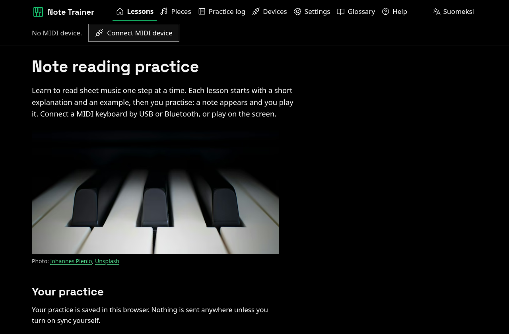

# Nuottitreeni (Note Trainer)

A free web app for learning to read sheet music and play it on a piano or keyboard. It runs in the browser, works with almost any MIDI keyboard, keeps working offline and stores your progress only in your own browser. Finnish and English.

**Use it free at <https://piano.markussilvo.fi>.** That is the official instance, run by the author. You can also run your own copy on Cloudflare with one button (see below).

[Suomeksi](README.fi.md)



## What it does

- **Lessons for reading notes.** Ten short lessons from the key names to the treble and bass clef, ledger lines, sharps and flats and key signatures. Each lesson explains the idea in plain words with a written-out example, then you practise: one note at a time, a row of notes, or by ear. When you miss, the app tells you why (which line or space, what the clef makes of it).
- **Rhythm.** Note values, rests and time signatures as untimed quizzes, and tapping rhythms with a metronome.
- **Pieces.** Built-in public-domain melodies (Ukko Nooa, Twinkle Twinkle, Ode to Joy, Minuet in G and more) to play from the score. The app waits for the right note, or follows a tempo you choose. You can also open your own MusicXML, MXL or MIDI files; they never leave your browser.
- **Your keyboard.** USB and Bluetooth MIDI keyboards through Web MIDI. Bluetooth LE MIDI and some older USB keyboards (for example Yamaha models in the maker's own USB mode) can be connected directly in Chromium browsers (experimental). The on-screen keyboard and your computer keyboard always work.
- **Sound, recordings and a practice log.** Piano sound in the browser, automatic recordings of what you play (download them as MIDI files), minutes per day and an optional daily goal.
- **Offline and installable.** After the first visit the app works without a network and can be installed as an app.
- **Accessible.** WCAG 2.2 AAA is the target: 7:1 contrast, large targets, full keyboard use, no time limits in the main exercises, text alternatives for the notation. See [ACCESSIBILITY.md](ACCESSIBILITY.md).
- **Private by design.** No accounts, cookies, analytics, ads or third-party requests. An optional sync code copies your progress between devices through the instance's own server, which stores practice statistics and nothing else. See [PRIVACY.md](PRIVACY.md).

## Which browsers and keyboards work

| Browser | MIDI keyboard | What else |
|---|---|---|
| Chrome, Edge, Opera, Brave on Windows, macOS, Linux and ChromeOS; Chrome on Android | Yes (Web MIDI) | Bluetooth LE MIDI and USB vendor mode (experimental) |
| Firefox on a computer | Yes, after allowing a site permission add-on | |
| Safari on macOS, iPhone and iPad; Firefox on Android | No (the browser has no Web MIDI) | On-screen and computer keyboard |

Device notes and troubleshooting: [docs/devices.md](docs/devices.md). If your keyboard does not work, a [device report](https://github.com/Markus-web/nuottitreeni/issues/new?template=device-report.yml) helps.

## Run your own copy

### Deploy to Cloudflare

[](https://deploy.workers.cloudflare.com/?url=https://github.com/Markus-web/nuottitreeni)

The button copies this repository to your GitHub or GitLab account, creates a Worker and a D1 database (for sync codes) and deploys the site. The free Workers plan is enough: pages and files are served as static assets and only `/api/*` runs the Worker.

After the first deploy, set `OPERATOR_NAME` and `OPERATOR_CONTACT` (shown on the privacy page) in the Worker settings. A copy is hidden from search engines until you set `NT_SITE_URL` and `NT_INDEXABLE=1` as build variables. Everything is explained in [docs/self-hosting.md](docs/self-hosting.md) and [docs/configuration.md](docs/configuration.md).

Sync codes work only on the instance that created them. Moving between instances: export your progress in Settings and import it on the other site.

### By hand

```bash
git clone https://github.com/Markus-web/nuottitreeni.git
cd nuottitreeni
npm ci
npx wrangler d1 create nuottitreeni   # copy the database_id into wrangler.jsonc
npm run build
npm run deploy                        # applies the D1 migrations, then deploys
```

## Develop

Node 22 and npm. No other tools are needed for the app itself.

```bash
npm ci
npm run dev       # build, local D1, then http://127.0.0.1:8797
npm test          # unit and Worker tests
npm run check     # tests, build, dry-run deploy and the browser suite
```

The browser suite (flows, WCAG 2.2 AAA matrix, SEO crawl, Lighthouse budgets) needs Chromium and its own packages: `npm ci --prefix tests/browser --ignore-scripts`. Details: [docs/testing.md](docs/testing.md). How the code fits together: [docs/architecture.md](docs/architecture.md).

## Contributing

Translations, public-domain pieces, lesson fixes, device reports and code are all welcome. Start with [CONTRIBUTING.md](CONTRIBUTING.md). Questions and ideas go to [Discussions](https://github.com/Markus-web/nuottitreeni/discussions). Security issues: [SECURITY.md](SECURITY.md).

## Licence

The code, texts, lessons and piece transcriptions are under the [MIT licence](https://github.com/Markus-web/nuottitreeni/blob/main/LICENSE). Bundled third-party parts keep their own licences: fonts (SIL OFL 1.1), piano samples (MIT), the notation engine (BSD-3-Clause), icons (MIT) and photos (Unsplash License, not MIT). The full list is in [THIRD_PARTY_NOTICES.md](THIRD_PARTY_NOTICES.md).
